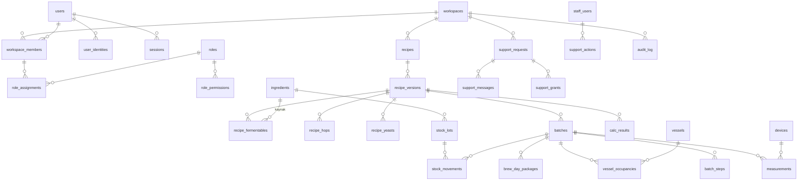

# ADR-0007: Veri modeli

**Durum:** kabul · **Tarih:** 13 Kasım 2026 · **İş:** T2.1

## Bağlam

Plan › Veri modeli varlıkları sayar; bu kayıt onları PostgreSQL tablolarına çevirir. Planın dediği gibi veri modeli sonradan değiştirmesi en pahalı kısım. Bu yüzden İşletme tabloları da şimdi tasarlanıyor (göçleri T2.7'de), uçları Aşama 6'da yazılacak. Dayanaklar: plan › Veri katmanı, Eşzamanlı düzenleme ve onay, Kullanıcılar ve roller, Güvenlik, Destek paneli, Destek talepleri; ADR-0004 (motor girdi modeli) ve ADR-0005 (gRPC, metrik birimler).

Bu kayıt tabloları, sütun kurallarını, ayrım ve bütünlük kurallarını belirler. Sütunların tam listesi ve tipleri göçlerde (T2.5–T2.7) yazılır ve bu kurallara uyar. Kimlik, oturum ve yetkinin işleyişi ADR-0009'da, API kuralları ADR-0008'de.

## Karar

### 1. Genel kurallar

1. **Kimlik:** her satırın birincil anahtarı `id uuid`, UUIDv7, uygulamada üretilir. Demleme günü ölçümü gibi istemcinin ürettiği kayıtlar istemcinin UUID'sini taşır (tekrar güvenliği). İnsana gösterilen numaralar ayrı sütundur: parti kodu (`batches.code`, çalışma alanında tekil), destek talep numarası (`support_requests.public_number`, genel sıra).
2. **Ortak sütunlar:** değiştirilebilen her tabloda `created_at`, `updated_at` (timestamptz, UTC), `deleted_at` (yumuşak silme), `version bigint` (iyimser kilit; her UPDATE'te tetikleyici bir artırır, API'de ETag) ve `created_by`, `updated_by` (kullanıcı kimliği; sistem işinde NULL). Yalnız eklenen tablolarda (ölçüm, olay, denetim kaydı, stok hareketi) yalnız `created_at` (ya da olayın zamanı) ve yazan bulunur.
3. **Adlar:** İngilizce, `snake_case`, tablo adı çoğul (`recipes`, `recipe_versions`). Ara tablo iki adı birleştirir (`role_permissions`).
4. **Birimler:** fiziksel büyüklükler motor sözleşmesindeki metrik birimlerle saklanır (ADR-0004 madde 4, ADR-0005): kütle kg, hacim L, sıcaklık °C, süre dakika, gravite SG, renk SRM, iyon mg/L (ppm), basınç bar, yüzde 0–100. Planın "iç birim SI" kararı bu metrik takımdır; L ve °C bilinçli seçimdir, m³ ve K değildir. Sütun adı birim ekini taşır (`amount_kg`, `boil_time_min`, `og_sg`, `temp_c`, `alpha_pct`); oranlar eksizdir. Şerbetçiotu ve katkı da kg'dır; kullanıcı birimi yalnız gösterimdir (T2.17).
5. **Sayı tipi:** fiziksel büyüklükler `double precision` (motor f64); para ve vergi `numeric(19,4)` ve yanında `currency char(3)` (rust_decimal, ADR-0003). Sayım (adet, şişe) `integer`.
6. **Sabit liste değerleri:** `text` ve `CHECK (... IN (...))`, Rust tarafında enum (sqlx). PostgreSQL `ENUM` tipi kullanılmaz; değer kaldırmak göçte zor.
7. **Sütun mu JSONB mi:** sorgulanan, süzülen, sıralanan, kısıt veya yabancı anahtar taşıyan her alan sütundur. JSONB yalnız şunlarda kullanılır: (a) değişmez anlık görüntüler (tarif sürümünün ekipman ve seçenek kopyası, demleme paketi içeriği, hesap sonucu çıktısı); (b) yapısı çok değişken, içinde arama yapılmayan ayarlar (çalışma alanı ayarları, uyarı kuralı koşulu, içe aktarma eşleştirme kararları); (c) denetim kaydının önceki ve yeni değeri. Her JSONB bir Rust tipine karşılık gelir, yazılmadan önce o tiple doğrulanır ve `schema_version` alanı taşır.
8. **Zaman:** an `timestamptz` (UTC); takvim günü (planlanan demleme günü) `date` ve çalışma alanının `time_zone` sütunu (IANA adı).
9. **Metin:** kullanıcıya gösterilen sistem metni veritabanında tutulmaz; bildirim ve olay satırları metin anahtarı ve parametre taşır (plan › Birimler ve yerelleştirme). Kullanıcının yazdığı metin (ad, not) olduğu gibi tutulur.
10. **Uzantılar:** yalnız `pg_trgm` (bulanık arama) ve `btree_gist` (tank doluluğunda çakışma kısıtı). İkisi de yönetilen PostgreSQL'lerin (Cloud SQL, RDS, Azure) hepsinde var. Özet ve imza hesapları Rust'ta yapılır, `pgcrypto` kullanılmaz.

### 2. Çalışma alanı ayrımı

1. **Üç tür tablo var.**
   - *Çalışma alanı tablosu:* `workspace_id uuid NOT NULL`. Tarif, parti, stok, bildirim gibi müşteri içeriğinin tamamı.
   - *Hesap tablosu:* kullanıcıya bağlı, çalışma alanından bağımsız (`users`, `user_identities`, `passkeys`, `sessions`, `email_login_tokens`, `push_targets`; `auth_requests` girişten önce olduğundan kullanıcısızdır ve yalnız madde 2.6'daki fonksiyonlarla erişilir).
   - *Ortak tablo:* herkesin okuduğu, yalnız göç ve tohum rolünün yazdığı veriler (ortak malzeme kütüphanesi, stil kılavuzları, vergi tabloları, varsayılan kaplar). Ortak kütüphane ile çalışma alanına özel kayıtlar aynı tabloda tutulur: `workspace_id` NULL ise satır ortaktır.
2. **RLS:** çalışma alanı tablolarının hepsinde `ENABLE` ve `FORCE ROW LEVEL SECURITY`. Politika `workspace_id = current_setting('app.workspace_id', true)::uuid`. Bağlam yoksa ayar NULL olur ve hiçbir satır eşleşmez. Ortak veri de tutan tablolarda okuma `workspace_id IS NULL OR workspace_id = bağlam`, yazma (`WITH CHECK`) yalnız `workspace_id = bağlam` olur. Hesap tablolarında politika `user_id = current_setting('app.user_id', true)::uuid` biçimindedir.
3. **Bağlam:** API her isteği tek işlemde yürütür ve başında `SET LOCAL app.user_id`, `app.workspace_id`, `app.actor_kind` (`user` / `support` / `system` / `device`) ayarlar (T2.10). Destek erişimi `actor_kind = support` ile ve `SET TRANSACTION READ ONLY` ile açılır. Bunu yalnız geçerli bir SupportGrant'ı denetleyen kod açar (T2.30).
4. **Veritabanı rolleri:**
   - `app_owner`: tabloların sahibi; yalnız göç ve tohum işi kullanır.
   - `app_api`: API ve ingest kullanır. Tablo sahibi değildir, `BYPASSRLS` yoktur.
   - `app_worker`: arka plan işleri kullanır. RLS altındadır. Çalışma alanları arası tablolara (madde 5) ayrıca yetkilidir; bir çalışma alanının işini o çalışma alanının bağlamında yapar.
   Hiçbir uygulama rolünde `BYPASSRLS` yoktur.
5. **Çalışma alanları arası tablolar** (RLS yerine hak ile korunur): `outbox`, `scheduled_jobs`, `external_events`. `app_api` bunlara yalnız INSERT yapar (ve kendi `external_events` tekrar denetimi için SELECT). Okuma ve silme yalnız `app_worker`'dadır. Bu tablolar müşteri içeriği taşımaz, yalnız kimlik ve olay yükü taşır.
6. **Girişten önceki aramalar** (bağlam henüz yokken): sağlayıcı kimliğiyle kullanıcı bulma, e-posta bağlantısını tüketme, oturum belirtecinin özetiyle oturum bulma, cihaz anahtarıyla cihaz bulma, davet belirteciyle davet bulma. Bunlar dar kapsamlı `SECURITY DEFINER` fonksiyonlardır, `app_owner`'a aittir ve `search_path`'leri sabittir. Her biri tek satır ve yalnız gereken sütunları döndürür. Başka yoldan bağlamsız okuma yoktur (ayrıntı ADR-0009).
7. **Çapraz çalışma alanı başvurusu engeli:** yabancı anahtar denetimi RLS'yi aşar. Bu yüzden çalışma alanı tablolarında üst kayda giden başvuru bileşik anahtarla yapılır: üst tabloda `UNIQUE (workspace_id, id)`, alt tabloda `FOREIGN KEY (workspace_id, parent_id) REFERENCES parent (workspace_id, id)`. Ortak olabilen kayda giden başvurular (malzeme, stil, kap türü) bileşik anahtarla yapılamaz. Bunları bir tetikleyici denetler: hedefin `workspace_id`'si NULL ya da satırınkiyle aynı olmalı.
8. **Test (T2.5–T2.7):** RLS testi `pg_catalog`'u tarar. `workspace_id` sütunu olup RLS'si ya da politikası olmayan tablo, madde 5 listesinde değilse test düşer. Bileşik anahtar eksikliği de aynı taramada aranır.

### 3. Tablolar

Kalın yazılanlar plan varlığıdır; ötekiler bu kayıtta eklenen yardımcı tablolardır (gerekçe madde 4'te).

**Hesap, çalışma alanı, yetki** (T2.5)

| Tablo | Not |
|---|---|
| **`workspaces`** | ad, `mode` (`home` / `business`), `region` (`us` / `uk`; değişmez), `country` (vergi ve mevzuat), `time_zone`, `support_pseudonym` (rastgele, kalıcı; GitHub'da yalnız bu görünür), `settings jsonb` |
| **`users`** | görünen ad, iletişim e-postası (doğrulanmış, isteğe bağlı), dil, `deleted_at`. E-posta kimlik değildir |
| **`user_identities`** | `provider` (`apple` / `google` / `email`), `subject` (sağlayıcıdaki kalıcı kimlik; e-postada normalize adres), bağlanma zamanı; `UNIQUE (provider, subject)`; Apple yenileme belirteci zarf şifreli (`provider_refresh_token_enc`, hesap silmede iptal için; ADR-0009) |
| `passkeys` | WebAuthn kimlik kaydı: kimlik bilgisi kimliği, açık anahtar, sayaç, ad, son kullanım (plan: UserIdentity'nin "passkey kayıtları") |
| `sessions` | opak belirtecin özeti, kullanıcı, istemci türü, cihaz adı, oluşturma, son etkinlik, bitiş, ikinci adım zamanı, kapatılma. Oturum listesi ve uzaktan çıkış buradan; Redis yalnız önbellek (ADR-0009) |
| `email_login_tokens` | tek kullanımlık giriş bağlantısı: özet, adres, bitiş, kullanılma |
| `auth_requests` | giriş denemesi: tek kullanımlık nonce, `state`, PKCE doğrulayıcısı, bitiş (10 dk) (ADR-0009) |
| `workspace_members` | kullanıcı ↔ çalışma alanı, durum (`active` / `disabled`), katılma. Politika: `user_id = app.user_id OR workspace_id = app.workspace_id` (kullanıcı kendi çalışma alanlarını listeleyebilsin) |
| **`roles`** | çalışma alanı rolü: ad, `template_key` (hazır rolden kopyalandıysa), açılış ekranı |
| `role_permissions` | rol × izin. İzinler kodda sabit bir listedir (`recipe.view`, `recipe.edit`, `recipe.approve`, …; plan › Yetki matrisi) ve sütun CHECK ile bu listeye bağlanır. Planın **Permission** varlığı tablo değil, bu listedir: yeni izin kodla birlikte gelir |
| **`role_assignments`** | üye × rol, isteğe bağlı kapsam (`scope_kind`: `vessel` / `area` / `recipe` / `batch`; `scope_id`). Ev modunda arkadaş paylaşımı bu yolla yapılır: arkadaş, sahibin çalışma alanına `recipe` veya `batch` kapsamlı düzenleyici ya da izleyici rolüyle üye olur. Ayrı paylaşım tablosu yoktur |
| **`invitations`** | belirtecin özeti, rol, kapsam, davet eden, bitiş (7 gün), kabul eden ve zamanı, iptal |
| `shared_devices` | ortak iPad: çalışma alanı, açan yönetici, cihaz anahtarının özeti, işlemsizlik süresi |
| `member_pins` | üyenin ortak cihaz PIN'inin özeti (Argon2id), hatalı deneme sayısı, kilit bitişi |
| **`device_sessions`** | ortak cihazda etkin kullanıcı: cihaz, üye, başlangıç, son etkinlik, bitiş |
| `push_targets` | kullanıcının push adresi (APNs belirteci, ortam, uygulama sürümü), son başarılı teslim, hata |
| `staff_users` | destek ekibi (ortak tablo, çalışma alanı dışı): Google Workspace kimliği, rol (`support` / `support_admin`), durum. Müşteri kullanıcılarıyla karışmaz |

**Kütüphane ve tanımlar** (T2.6; çoğu ortak + çalışma alanına özel)

| Tablo | Not |
|---|---|
| **`ingredients`** | tek kimlik tablosu: `kind` (`fermentable` / `hop` / `yeast` / `misc`), ad, üretici, ürün kodu, köken, not, fiyat (kg başına, para birimiyle), `source` (`library` / `user`), `search tsvector` |
| `ingredient_fermentables`, `ingredient_hops`, `ingredient_yeasts`, `ingredient_miscs` | türe özgü sütunlar, `ingredients` ile 1:1 (`id` aynı). Sütunlar motorun girdi alanlarıyla aynı adı ve birimi taşır (`yield_pct`, `color_srm`, `alpha_pct`, `min_attenuation_pct`, …). Malzemeye giden her başvuru (tarif, stok, alışveriş) tek `ingredients.id`'ye gider |
| **`equipment`** | ekipman profili: hacimler, kayıplar, verim, rakım, şerbetçiotu kullanımı; motorun `Equipment` alanları ve 05 hacim girdileri sütun olarak |
| `mash_profiles`, `mash_profile_steps` | **Profile** (mash) ve adımları |
| `fermentation_profiles`, `fermentation_profile_steps` | **Profile** (fermantasyon): adım sıcaklığı, süre, rampa |
| `carbonation_profiles` | **Profile** (karbonasyon): yöntem, hedef hacim, sıcaklık |
| `water_profiles` | kaynak suyu ve hedef profiller: iyonlar (mg/L), pH, alkalinite; su analiz raporundan gelenler `source_document_id` ile taranan belgeye bağlanır |
| **`style_guides`**, **`styles`**, **`style_mappings`** | kılavuz (ad, yıl, lisans notu), stil aralıkları sütun olarak (`og_min_sg`, `og_max_sg`, `ibu_min`, …), kılavuzlar arası eşleşme. Kullanıcı kılavuzu `workspace_id` ile |
| **`package_types`** | **PackageType**: tür (`bottle` / `can` / `keg` / `cask`), hacim, tek kullanımlık mı, malzeme, ağırlık; varsayılanlar ortak |

**Tarif** (T2.6)

| Tablo | Not |
|---|---|
| **`recipes`** | tarifin kimliği: güncel ad, klasör, kişisel kilit, son onaylı sürüm, taslak sürüm, `search tsvector` |
| **`recipe_versions`** | sürüm: sıra numarası, `status` (`draft` / `in_review` / `approved` / `archived`), onaylayan ve zaman, hesaplandığı motor sürümü. Başlık alanları sütundur: tür, stil, parti hacmi, kaynatma süresi, verim, hedefler. Yanında anlık görüntüler: `equipment_snapshot`, `mash_snapshot`, `fermentation_snapshot`, `water_snapshot`, `options` (JSONB, madde 1.7a). Ev modunda "yayınla" taslağı doğrudan `approved` yapar; İşletmede `in_review` adımı vardır (plan › Eşzamanlı düzenleme) |
| `recipe_fermentables`, `recipe_hops`, `recipe_yeasts`, `recipe_miscs` | **IngredientUse**: sürüm × malzeme. Kullanım alanları (miktar, kullanım, süre, sıcaklık) ve hesapta kullanılan malzeme özelliklerinin anlık kopyası sütun olarak (`yield_pct`, `alpha_pct`, …). `ingredient_id` kaynak gösterir; kütüphane değişse de tarif değişmez. Sıra `position` |
| `recipe_water_additions` | tuz ve asit eklemeleri (su ve pH ekranı) |
| `folders`, `tags`, `recipe_tags`, `batch_tags`, `favorites` | liste ekranının klasör, etiket ve favorileri; favori kullanıcıya özeldir |

Değişmezlik: `status <> 'draft'` olan sürümde ve onun malzeme satırlarında içerik değiştiren UPDATE ve DELETE'i tetikleyici reddeder; yalnız `status` geçişi (→ `archived`) serbesttir. Tarif başına en çok bir taslak vardır (`status = 'draft'` üzerinde kısmi tekil indeks). Taslak sık güncellenir (istemci yaklaşık 300 ms'de bir toplu gönderir), her güncellemede `version` artar.

**Parti ve demleme günü** (T2.6)

| Tablo | Not |
|---|---|
| **`batches`** | kod, `recipe_version_id` (İşletmede yalnız `approved` sürüm: tetikleyici), ekipman, aşama, planlanan ve gerçek tarihler, hedef ve gerçek hacim, hesaplandığı motor sürümü |
| **`batch_steps`** | planlanan ve gerçek başlangıç ve bitiş, durum, giriş kaynağı (`timer` / `manual` / `paper`), adımı kapatan |
| **`batch_ingredient_actuals`** | gerçek miktar, ikame malzeme, ilgili tarif satırı |
| **`deviations`** | plandan sapma: tür, açıklama, ilgili adım ve satır; İşletmede kalite sapma kaydı da bu tablo (`severity`, kapanış) |
| **`measurements`** | zaman damgalı ölçüm: tür (SG, sıcaklık, pH, …), değer (SI), `measured_at`, `source` (`device` / `manual` / `paper`), cihaz, giren, paket kimliği. `measured_at` üzerinde aylık aralık bölümlü. Birincil anahtar `(id, measured_at)` (bölüm anahtarı anahtara girmek zorunda); istemci aynı ölçümü aynı UUID ve zamanla yeniden gönderir, ikinci kayıt oluşmaz. Bölümleri `app_worker` iki ay önceden açar; eski bölümün özetlenip arşive taşınması Aşama 5'te |
| **`stage_events`** | aşama geçişleri (yalnız eklenir) |
| `tasting_notes` | parti özeti ekranının tadım notu ve puanı |
| **`brew_day_packages`** | parti, içerik sürümü, `content jsonb` (sunucuda hesaplanan adım, sayaç, hedef, alarm zamanları), imza ve anahtar kimliği, oluşturma, bitiş, iptal |
| **`calc_results`** | `kind` (tarif özeti, su, mash hacmi, …), `input_hash bytea` (kanonik girdinin SHA-256'sı), motor sürümü, `output jsonb`; tarif sürümüne veya partiye bağlı. `UNIQUE (workspace_id, kind, input_hash, engine_version)`. Redis önbelleği bunun önündedir ve kaybolabilir; burada saklanan sonuç değişmez |

**Stok** (T2.6)

| Tablo | Not |
|---|---|
| **`stock_lots`** | malzeme, lot kodu (evde tek varsayılan lot), tedarikçi, kabul ve son kullanma tarihi, birim maliyet, `quantity` (önbellek, madde 3 altı) |
| **`stock_movements`** | defter (yalnız eklenir): tür (`receive` / `consume` / `adjust` / `count` / `transfer`), miktar (SI, işaretli), parti, zaman, gerekçe |
| `shopping_list_items` | alışveriş listesi: malzeme, miktar, kaynak tarif sürümü, işaretli mi |

Toplam: doğruluk kaynağı hareketlerdir. `stock_lots.quantity` aynı işlemde bir tetikleyiciyle güncellenir; lot satırı kilitlendiği için eşzamanlı iki hareket sıraya girer. Eksi stok reddedilmez, uyarı olarak döner. Günlük bir iş toplamı hareketlerden yeniden hesaplar; fark çıkarsa alarm verir.

**Bildirim, cihaz, dosya** (T2.6)

| Tablo | Not |
|---|---|
| **`notifications`** | alıcı üye, öncelik (1–3), tür, metin anahtarı ve parametreleri, parti ve adım, durum (`open` / `snoozed` / `acknowledged` / `dismissed` / `resolved`), erteleme bitişi |
| **`notification_events`** | gönderildi, okundu, onaylandı, ertelendi: kim, hangi cihaz (`push_target`), ne zaman, push sonucu |
| **`reminders`** | kural, zaman, bağlı adım; tetiklenmesi `scheduled_jobs` üzerinden |
| **`alert_rules`** | koşul (`jsonb`, Rust tipi), öncelik, kapsam (parti, tank, cihaz), susturma |
| **`devices`** | tür (`ispindel` / `rapt` / `tilt` / …), ad, veri adresi anahtarının özeti ve yenilenme zamanı, bağlı parti veya tank, kalibrasyon (`jsonb`), son veri |
| **`attachments`** | parti fotoğrafı ve notu, tadım fotoğrafı: nesne anahtarı, tür, boyut, SHA-256, bağlı kayıt |
| **`scanned_documents`** | parti, form türü, tarayan, nesne anahtarı, saklama bitişi, yasal tutma |
| **`import_sources`** | yüklenen dosya (nesne anahtarı), biçim, çözümleme durumu, eşleştirme kararları (`jsonb`), oluşan tarif |
| `export_jobs` | dışa aktarma ve hesap verisi talebi: kapsam, biçim, durum, sonuç nesnesi, bitiş |

**Abonelik ve destek** (T2.6)

| Tablo | Not |
|---|---|
| **`subscriptions`** | kaynak (`app_store` / `web`), dış kimlik (App Store `original_transaction_id`), durum, dönem bitişi, deneme bitişi, son doğrulama. Yalnız sunucu yazar |
| **`entitlements`** | çalışma alanının açık özelliği, kaynağı, geçerlilik; elle düzeltmede gerekçe ve düzelten (destek) |
| **`support_requests`** | `public_number` (genel sıra), açan, konu, başlık, isteğe bağlı ilgili kayıt, durum (`open` / `answered` / `resolved` / `closed`), tanılama özeti, GitHub Issue numarası, son eşitleme, önceki talep |
| **`support_messages`** | yazar türü (`customer` / `staff` / `system`), yazar, metin, görünürlük (`customer` / `internal`), GitHub yorum kimliği, düzenlenme ve geri çekilme zamanı; ekler `attachments` üzerinden |
| **`support_grants`** | veren üye, bağlı talep, başlangıç, bitiş (72 saat), iptal; acil erişimde iki onaylayan ve müşteriye bildirim zamanı |
| **`support_actions`** | destek ekibinin her işlemi: kim (`staff_users`), neye, ne yaptı, gerekçe, talep. Yalnız eklenir; aynı olay denetim kaydına da yazılır |

**Altyapı tabloları** (T2.5)

| Tablo | Not |
|---|---|
| `outbox` | olay: konu, çalışma alanı, yük, oluşma; kaydı yazan işlemle aynı işlemde eklenir. Aktarıcı NATS'a yazar, `published_at`'i işaretler, eskiyi siler (plan › Veri katmanı › Kuyruk) |
| `idempotency_keys` | (çalışma alanı veya kullanıcı, anahtar) → istek özeti, yanıt durumu ve gövdesi, bitiş (24 saat). Aynı anahtar farklı gövdeyle gelirse istek reddedilir (ADR-0008) |
| `external_events` | dış olay alımı: kaynak (`github` / `app_store` / `web_payment` / `device`), teslim kimliği (`UNIQUE (source, delivery_id)`), alınma, işlenme. Aynı teslim iki kez işlenmez |
| `scheduled_jobs` | zamanı gelen işler (hatırlatıcı, deneme bitişi, kalıcı silme, bölüm açma): çalışma alanı, tür, zaman, durum |
| `change_history` | geri alınabilir değişiklik geçmişi: tablo, kayıt, sürüm, önceki değer (`jsonb`), değiştiren. Ekipman, profil, kütüphane ve taslak tarif için (plan: "son yazan kazanır + değişiklik geçmişi"). Saklama süreli; denetim kaydı değildir |
| **`audit_log`**, `audit_heads` | madde 5; `audit_heads` çalışma alanı başına zincirin son sıra numarası ve özeti |

**İşletme** (T2.7; uçları Aşama 6)

| Tablo | Not |
|---|---|
| **`vessels`** | tank ve kazan: tür, hacim, alan, temizlik durumu |
| `production_areas` | yetki kapsamı için üretim alanı |
| **`vessel_occupancies`** | parti ↔ tank, zaman aralığı (`tstzrange`) ve hacim; çoktan çoğa (bölme ve birleştirme). Aynı tanka çakışan iki doluluk `EXCLUDE USING gist` ile engellenmez, planlama uyarısıdır (plan › Eşzamanlı düzenleme › Tank planı). Engel yalnız gerçekleşen (`actual`) dolulukta |
| **`transfers`** | kaynak ve hedef tank, partiler, hacim, kayıp, zaman, yapan |
| **`packaging_runs`**, `packaging_run_lines` | **PackagingRun**: parti, kap türü, adet, litre, lot, karbonasyon yöntemi |
| **`quality_specs`**, **`lab_results`**, **`releases`** | spesifikasyon aralıkları, laboratuvar ve tadım sonuçları, serbest bırakma kararı (kim, ne zaman) |
| **`cleaning_records`** | CIP: tank, kimyasal, konsantrasyon, sıcaklık, süre, doğrulama |
| **`yeast_generations`** | maya hasadı ve jenerasyon zinciri (üst jenerasyon, kaynak parti, hedef partiler) |
| `tax_jurisdictions`, `tax_rate_tables`, `tax_rate_bands` | ortak tablolar: ülke, yöntem, yürürlük aralığı, bant ve kademe, indirim (T2.8 motora girdi olarak verir) |

### 4. Plan varlıklarının karşılığı

| Plan varlığı | Karşılık |
|---|---|
| Workspace, User, Role, RoleAssignment, Invitation, DeviceSession, UserIdentity | Aynı adlı tablolar. Ek olarak `workspace_members` (kullanıcı birden çok çalışma alanına üye olur; rol ataması üyeye yapılır), `passkeys`, `sessions`, `email_login_tokens`, `shared_devices`, `member_pins` |
| Permission | Tablo değil, kodda sabit izin listesi; `role_permissions` CHECK ile bağlı (madde 3) |
| Recipe, RecipeVersion | Aynı; anlık görüntüler sürümde |
| Ingredient, IngredientUse | `ingredients` ve türe göre 1:1 tablolar; IngredientUse türe göre dört tablo (`recipe_fermentables`, …). Gerekçe: her türün alanları farklı ve tipli sütun olarak kısıt taşımalı; malzemeye giden başvuru yine tek kimliğe gider |
| Equipment, Profile | `equipment`; Profile türüne göre ayrı tablolar (mash, fermantasyon, karbonasyon, su) |
| StyleGuide, Style, StyleMapping | Aynı |
| Batch, BatchStep, BatchIngredientActual, Deviation, Measurement, StageEvent | Aynı; ek `tasting_notes` |
| Vessel, VesselOccupancy, Transfer | Aynı; ek `production_areas` |
| StockLot, StockMovement | Aynı; ek `shopping_list_items` |
| ScannedDocument, ImportSource, Attachment | Aynı; ek `export_jobs` |
| AuditLog | `audit_log` (madde 5); ayrıca `change_history` |
| EditSession | **Tablo değil:** Redis'te süreli anahtar (tarif taslağı → düzenleyen, son etkinlik) ve SSE olayı. Kısa ömürlü ve kaybolursa yalnız uyarı kaybolur; plan › Veri katmanı Redis için bunu kabul ediyor. Çakışma güvenliği `version` ile sağlanır |
| PackageType, PackagingRun | Aynı; ek `packaging_run_lines` |
| Notification, NotificationEvent, Reminder | Aynı; ek `push_targets` |
| CalcResult | `calc_results` |
| SupportGrant, SupportAction, SupportRequest, SupportMessage | Aynı; ek `staff_users` |
| Device, AlertRule | Aynı |
| BrewDayPackage | `brew_day_packages` |
| QualitySpec, LabResult, Release | Aynı |
| CleaningRecord, YeastGeneration | Aynı |
| Subscription, Entitlement | Aynı |

### 5. Denetim kaydı

1. **Yazılanlar:** rol, izin, üyelik ve davet değişiklikleri; tarif onayı ve arşivi; kapanmış partide düzeltme (gerekçe zorunlu); silme ve geri getirme; abonelik ve yetkinin elle düzeltilmesi; destek erişimi ve her `support_actions` satırı; giriş yöntemi ekleme ve kaldırma, passkey, oturum kapatma; cihaz anahtarı yenileme; dışa aktarma ve hesap silme. Taslak düzenlemesi gibi sık değişiklikler `change_history`'ye gider, denetim kaydına gitmez.
2. **Satır:** çalışma alanı, sıra numarası (çalışma alanında artan), zaman, yapan türü ve kimliği, eylem, kayıt türü ve kimliği, önceki ve yeni değer (`jsonb`), gerekçe, `prev_hash`, `hash`.
3. **Zincir:** `hash = SHA-256(prev_hash ‖ kanonik satır)`, çalışma alanı başına ayrı zincir. Kanonik biçim (alan sırası sabit JSON, RFC 8785) ve hesap Rust'ta, doğrulama komutu da Rust'ta (T2.14). Ekleme `audit_heads` satırını kilitleyerek sıraya girer; çalışma alanları birbirini beklemez.
4. **Yalnız eklenir:** `app_api` ve `app_worker` rollerinin yalnız INSERT ve SELECT hakkı var. UPDATE, DELETE ve TRUNCATE'i bir tetikleyici sahip rolde de reddeder.
5. **Kişisel veri:** denetim satırı kişiyi yalnız UUID ile anar. Ad, e-posta ve serbest metin önceki ve yeni değere yazılmaz; bu alanlar için "değişti" işareti ve değerin özeti yazılır. Böylece hesap silinince denetim satırını yeniden yazmak gerekmez: UUID'nin karşılığı silinir, satır anonim kalır, zincir bozulmaz.

### 6. Silme, saklama, anonimleştirme

1. **Yumuşak silme:** kullanıcının sildiği kayıt `deleted_at` alır, listelerden çıkar ve saklama süresi içinde geri getirilebilir (30 gün, doğrulanacak). Süre dolunca `scheduled_jobs` kaydı kalıcı olarak siler. Yalnız eklenen tablolar (ölçüm, hareket) tek tek silinmez; bağlı oldukları kayıtla birlikte gider.
2. **Hesap silme** (T2.31): kullanıcının kimlikleri, passkey'leri, oturumları ve push adresleri silinir. `users` satırı mezar taşı olarak kalır: kişisel alanlar boşaltılır, `deleted_at` dolar. Böylece başka kayıtlardaki `created_by` gibi başvurular bozulmaz ve "silinmiş kullanıcı" olarak görünür. Kullanıcının tek sahibi olduğu Ev çalışma alanı bütün içeriğiyle silinir; destek talepleri, mesajları ve ekleri de silinir (plan › Destek talepleri › Kişisel veri). İşletme çalışma alanında saklanması zorunlu kayıtlar kalır, kullanıcı yalnız anonim UUID olarak görünür.
3. **Çalışma alanı silme:** bütün çalışma alanı tabloları `workspace_id` ile silinir (bileşik anahtarlarda `ON DELETE CASCADE`); nesne deposundaki dosyalar iş kuyruğuyla silinir. Yasal tutma işaretli belge (`scanned_documents.legal_hold`) süresi dolmadan silinmez.

### 7. Veri yeri

1. Her bölge (ABD, İngiltere) ayrı bir kurulumdur: ayrı veritabanı, nesne deposu ve küme (hücre). Çalışma alanı açılırken bölgesini seçer, `workspaces.region` değişmez. Tablolar arasında bölgeler arası yabancı anahtar yoktur; UUID'ler genel olarak tekildir, bu yüzden ileride birleştirme ve taşıma çakışmaz.
2. Kullanıcı iki bölgede çalışma alanına üye olursa her bölgede ayrı bir `users` satırı vardır; sağlayıcı kimliği aynıdır. Girişte doğru bölgeye yönlendiren dizin (yalnız sağlayıcı kimliğinin özeti → bölge eşlemesi) ilk bulut kurulumunda (Aşama 5) ayrı bir ADR'yle kararlaştırılır. Aşama 2–4 tek bölgededir; şema bu dizini gerektirmez.

### 8. Arama

`recipes`, `batches`, `ingredients`, `stock_lots` tablolarında `search tsvector` üretilmiş sütunu ve GIN indeksi var; yapılandırma `simple` (dil bağımsız). Ad sütunlarında `pg_trgm` indeksi (yazım hatasına dayanıklı arama). Global arama bu tabloların birleşimidir ve RLS altında çalışır (T2.27).

### 9. Diyagram (çekirdek ilişkiler)

## Sonuçlar

- Göçler üç dalgada yazılır: T2.5 hesap, yetki ve altyapı; T2.6 Ev MVP; T2.7 İşletme. Her dalga bu kayıttaki adları kullanır. Bir ad veya sütun değişirse bu kayıt aynı commit'te güncellenir.
- RLS ve bileşik anahtar ikisi birden çalışma alanı ayrımını taşır; ikisi de katalog taraması ile testte zorlanır (madde 2.8). Uygulama kodundaki bir süzme hatası tek başına başka çalışma alanının verisini açmaz.
- Motor girdisi sürümün sütunlarından ve anlık görüntülerinden kurulur. Birimler aynı olduğu için API ile motor arasında yalnız alan eşlemesi var, dönüşüm yok (dönüşüm engine-service'te kalır, ADR-0004).
- EditSession ve oturum önbelleği Redis'te; Redis kaybı veri kaybı değildir (plan › Veri katmanı).
- Açık: saklama süreleri (yumuşak silme 30 gün, değişiklik geçmişi, ölçüm arşivi, doğrulanacak); bölge dizini (Aşama 5 ADR); ölçüm bölümlerinin arşive taşınması (Aşama 5).
- T2.5 uygulama notları: (1) Politikalar `current_setting` değerini `app_workspace_id()` / `app_user_id()` işlevleriyle okur; `SET LOCAL` bitince ayar NULL değil boş metin olduğu için işlev `NULLIF` uygular, yoksa uuid dönüşümü hata verir. (2) `workspace_members` okuma politikası madde 3'teki gibidir (`user_id = bağlam OR workspace_id = bağlam`); ekleme, güncelleme ve silme yalnız `workspace_id = bağlam` olur, yoksa kullanıcı kendi üyeliğini değiştirebilirdi. (3) Girişten önceki işlevler `app_owner` olarak çalışır; FORCE RLS sahibi de bağladığından yalnız ilgili tablolarda `app_owner`'a açık `owner_lookup` politikası vardır (`tests/catalog.rs` listeyi zorlar). `email_login_tokens` ve `auth_requests` uygulama rollerine tamamen kapalıdır, yalnız işlevlerle erişilir. (4) `audit_log` silme tetikleyicisi, yalnız yabancı anahtar zincirinden gelen silmeye (çalışma alanı silme, madde 6.3) izin verir (`pg_trigger_depth() > 1`). (5) `idempotency_keys` çalışma alanı ya da kullanıcı kapsamlıdır (tam biri dolu); süresi dolanları worker `purge_expired_idempotency_keys()` ile siler. (6) Parolalar göçlerde değil, göçten sonra `migrate` ikilisinde ortamdaki sırlarla verilir. (7) Kimlik, oturum ve token tablolarında `deleted_at` yoktur (madde 6.2: silinir); `users` ve kimlik tablolarında `created_by`/`updated_by` yoktur (kullanıcı kendi kaydını yazar).
- İnceleme: F2.1 bu kaydı ve göçleri bağımsız inceler.
- T2.6 uygulama notları (göçler `0007`–`0013`): (1) **Ortak satır yazımı:** ortak kütüphane tablolarında (`ingredients`, `ingredient_*`, `style_guides`, `styles`, `style_mappings`, `package_types`) okuma `workspace_id IS NULL OR = bağlam`; ekleme, güncelleme, silme yalnız `= bağlam` ve ayrı politikalardır. Göç ve tohum işinin ortak satır yazabilmesi için bu tablolarda `app_owner`'a açık `owner_seed` politikası vardır (FORCE RLS sahibi de bağlar); `tests/catalog.rs` `OWNER_SEED` listesini zorlar. (2) **Ortak hedefe başvuru:** bileşik anahtar kurulamayan başvurular (`ingredient_id`, `style_id`, `guide_id`, `from/to_style_id`, `substitute_ingredient_id`) düz yabancı anahtar ve `shared_ref_<sütun>` tetikleyicisiyle (`check_shared_ref`) korunur; hedef görünür ve `workspace_id` NULL ya da aynı olmalı. Tetikleyicisi olmayan başvuruyu katalog testi yakalar. (3) **1:1 tür tabloları** (`ingredient_fermentables`, …): ortak satırda `workspace_id` NULL olduğundan bileşik anahtar eşleşmeyi atlar; `check_ingredient_subtype` tetikleyicisi üst kaydın varlığını, türünü ve aynı `workspace_id`'yi denetler. (4) **Değişmezlik:** `draft` her şeye açık (yayınlama dahil); `in_review` yalnız `status` (→ `draft`, `approved`) ve onay alanlarını değiştirir; `approved` yalnız `archived`'a geçer; `archived` değişmez. Satır tablolarında (`recipe_*`) üst sürüm `draft` değilse ekleme, güncelleme, silme reddedilir. Doğrudan DELETE reddedilir, yabancı anahtar zincirinden gelen silme (tarif ya da çalışma alanı silme; `pg_trigger_depth() > 1`) geçer. Tarif başına tek taslak kısmi tekil indeksle. (5) **Parti–sürüm:** parti yalnız `approved` ya da sonradan `archived` olmuş sürümden açılır; İşletmede yalnız `approved` (ADR'den sıkı: Evde de taslak ve incelemedeki sürüm reddedilir, çünkü değişebilir). (6) **`measurements`:** aylık bölümler `create_measurement_partition(date)` ile açılır (SECURITY DEFINER, yalnız göç/`app_owner`); `ensure_measurement_partitions(n)` (yalnız `app_worker`) bu aydan n ay sonrasına kadar açar. Politika bölümlere kalıtılmadığı için işlev her bölümde RLS, FORCE ve politikayı kurar; katalog taraması bölümleri de kapsar. İlk bölümler 2026-01'den göç gününden iki ay sonrasına. Bölümü olmayan zamana ekleme `23514` ile düşer; eşleşen bölüm açıkken uygulama rollerinin bölüme doğrudan hakkı yoktur, ekleme üst tablodan. `ON CONFLICT DO NOTHING`, RLS'ye takılan (başka çalışma alanının) aynı `(id, measured_at)` için de sessizce atlar; tekillik genel UUID'ye dayanır. (7) **Stok:** `stock_lots.quantity` yalnız `stock_movements` ekleme tetikleyicisiyle değişir (elle güncelleme tetikleyici derinliğiyle reddedilir); `quantity` lotun biriminde (`unit`: `kg`, `l`, `count`) işaretli farktır, `count` ve `adjust` sayım farkını taşır. Günlük toplam yeniden hesabı henüz yok. (8) **Kapsam tetikleyicisi (T2.5 notu):** `check_polymorphic_target`; `role_assignments`, `invitations`, `alert_rules` kapsamını ve `attachments` bağlı kaydını denetler. `vessel` ve `area` hedef tabloları T2.7'de gelir, o zamana dek bu türler reddedilir (tablo `to_regclass` ile aranır, T2.7'de tetikleyici değişmeden çalışır). Hedef (`recipes`, `batches`, `devices`, `tasting_notes`, `support_messages`) silinince bağlı atama, davet (ve uygun olanlarda alarm kuralı ve ek) `drop_scope_references` ile silinir. `batch_ingredient_actuals.line_id` için `batch_actual_check_line` satırın partinin tarif sürümüne ait olduğunu denetler. (9) **Yazma yetkisi:** `subscriptions` ve `entitlements` yalnız `app_worker` yazar (`app_api` yalnız okur; destek elle düzeltmesi T2.30'da worker işi ya da yeni hak olarak kararlaştırılır). `measurements`, `stage_events`, `stock_movements`, `notification_events`, `support_actions` uygulama rollerine yalnız SELECT ve INSERT verir (silme yalnız yabancı anahtar zincirinden); `calc_results` SELECT, INSERT, DELETE. `favorites` çalışma alanı politikasına ek kısıtlayıcı `user_id = bağlam` politikası taşır. (10) **Seçimler:** `support_requests.public_number` `GENERATED ALWAYS AS IDENTITY` (genel sıra, ADR madde 1.1); `support_grants` en çok 72 saat (CHECK) ve acil erişimde iki farklı onaylayan; `scanned_documents` yasal tutmada süre dolmadan silmeyi (çalışma alanı silme zinciri dahil) tetikleyici reddeder (madde 6.3); `devices.vessel_id` yabancı anahtarsız, T2.7'de eklenir. `scheduled_jobs` ve `external_events` gibi çalışma alanları arası tablolara T2.6 eklemedi. Arama: `ingredients`, `recipes`, `batches`, `stock_lots` üzerinde `search` üretilmiş sütunu ve GIN indeksi; `ingredients`, `styles`, `recipes`, `batches` ad sütunlarında `pg_trgm` indeksi (göç `CREATE EXTENSION pg_trgm` çalıştırır: göç rolü yetkili olmalı). (11) **Açık:** cihaz veri adresi anahtarıyla cihaz bulma (girişten önceki arama işlevi, ingest) Aşama 3'te; destek ekibinin çalışma alanları arası talep kuyruğu (RLS çalışma alanı bağlamlıdır) T2.30'da; stok toplamının günlük yeniden hesabı ve ölçüm bölümlerini açan zamanlanmış iş worker'da.
