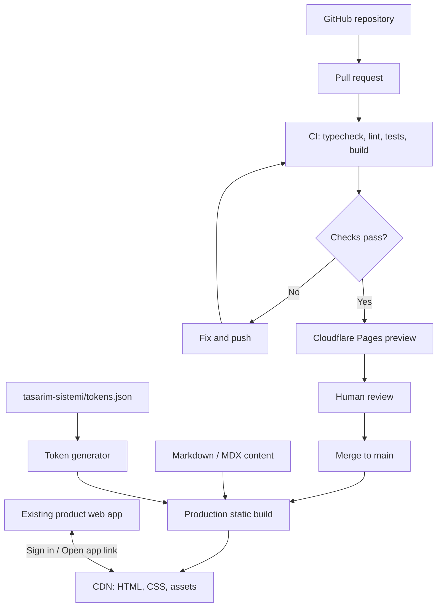

# Web teknik mimarisi — öneri

**Durum:** Mimari öneri; kullanıcı onayı sonrası teknoloji kararı olarak kilitlenecek.  
**Kapsam:** Yalnızca Demleme pazarlama / tanıtım / self-service edinim sitesi. Ürün web uygulaması bu kapsamda değildir.

## 1. Karar özeti

**Önerilen stack: Astro + TypeScript (strict) + statik üretim (SSG).**

- Astro: sayfa ve içerik ağırlıklı pazarlama sitesi.
- TypeScript: tüm yardımcı mantık, içerik şemaları ve etkileşimli bileşenler.
- Astro components: varsayılan sayfa bileşenleri.
- React: yalnız gerçek ihtiyaç çıkarsa küçük, bağımsız interaktif adalarda. İlk sürümde zorunlu değil.
- MDX / Markdown Content Collections: kaynaklar, rehberler, teknik makaleler.
- CSS custom properties: tasarım sistemi token'ları. Tailwind zorunlu değil.
- Hosting: Cloudflare Pages ilk aday; Git tabanlı build, preview ve CDN. Nihai seçim domain, analytics, form ve maliyet kararlarıyla verilir.
- Backend/database: ilk sürümde yok. Pazarlama sitesi ürün API'sini veya veritabanını yeniden kurmaz.

Astro'nun server-first ve islands yaklaşımı, içerik sayfalarının çoğunu tarayıcıya gereksiz JavaScript göndermeden sunar. Astro sayfaları varsayılan olarak build sırasında statik üretilebilir; gerektiğinde yalnız seçili route'lar sonradan SSR'a alınabilir.

## 2. Framework karşılaştırması

| Aday | Güçlü yanı | Bu proje için dezavantaj | Karar |
| --- | --- | --- | --- |
| **Astro** | İçerik ve marketing siteleri için tasarlanmış; SSG, içerik koleksiyonları, adacık mimarisi, React/Svelte entegrasyonları | Çok dinamik uygulama ekranları ana kullanım alanı değil | **Birinci tercih** |
| Next.js App Router | React ekosistemi, server/client components, dinamik ürün ve hesaplı kullanıcı deneyimleri | Bu pazarlama kapsamı için daha fazla runtime ve mimari yüzey; mevcut ürün web uygulaması zaten ayrı React/Vite | İkinci tercih; pazarlama sitesi uygulamaya dönüşürse tekrar değerlendir |
| SvelteKit | SSG/SSR seçenekleri, küçük etkileşimli uygulamalar, TypeScript | Ekip ve mevcut web kodu React/TypeScript; ek bir UI ekosistemi oluşturur | Bu kapsamda gerek yok |

Bu karar bir benchmark iddiası değildir. Framework seçimi ürünün içerik ağırlığı, mevcut repo ve işletim ihtiyacına göre yapılmıştır.

## 3. Dil ve AI geliştirme uyumu

**TypeScript seçilsin.** AI kodlama araçlarının TypeScript'i her koşulda diğer dillerden daha iyi ürettiği iddia edilmiyor. Tercih gerekçesi:

- Mevcut `web/` uygulaması React + TypeScript kullanıyor.
- TypeScript; bileşen prop'ları, içerik şemaları ve veri modelleri için statik kontrol sağlar.
- Tek ana dil, tekrar kullanılabilir örnekler ve tutarlı kod üretimi sağlar.
- Astro, `.astro`, `.ts` ve `.tsx` dosyalarında TypeScript desteği sunar.

Kurallar:
- `strict: true` (Astro `strict` veya `strictest` şablonu).
- `any` kullanımını yasakla; bilinmeyen girdileri `unknown` olarak ele al ve doğrula.
- İçerik frontmatter ve harici veri şemalarını Zod ile doğrula.
- JS dosyası açma; yapılandırma ve script zorunlu değilse TypeScript kullan.
- AI ajanına her görevde ilgili route, component, schema ve kabul kriterlerini ver; tüm repoyu prompt'a koyma.
- Değişiklik sonrası typecheck, lint ve build çalıştır.

## 4. Repo yerleşimi

Mevcut `web/` dizini ürünün React/Vite web uygulamasıdır. Pazarlama sitesi bunun yerine geçmemeli ve bağımsız kalmalıdır.

Önerilen yeni dizin:

```text
marketing-site/
  src/
    components/
      layout/
      navigation/
      sections/
      ui/
    content/
      resources/
      guides/
      faqs/
    content.config.ts
    layouts/
    pages/
      index.astro
      homebrewing/
      breweries/
      platform/
      calculations/
      features/
      pricing/
      resources/
      about/
      security/
      faq/
    styles/
      global.css
      tokens.css
    lib/
      seo.ts
      analytics.ts
      links.ts
    data/
      navigation.ts
      audiences.ts
  public/
    images/
    fonts/       # yalnız lisanslı web fontları
    favicon/
    robots.txt
  tests/
  astro.config.ts
  tsconfig.json
  package.json
  README.md
```

İsimlendirme öneridir; mevcut kök düzeni incelenerek uygulanır. Root package/workspace yapısı bu iş için değiştirilmez. `web/` ürün uygulamasının bağımlılıkları ve build'i etkilenmez.

## 5. Rendering ve tarayıcı mimarisi

- Tüm pazarlama sayfaları varsayılan olarak prerender / SSG.
- İçerik HTML olarak build çıktısına girer; SEO ve ilk render için istemci JS'e bağımlı olunmaz.
- Navigasyon, hero, feature anlatımı, FAQ ve makale sayfaları Astro bileşenleriyle sunulur.
- Menü, hesaplayıcı örneği veya filtre gibi gerçekten etkileşim isteyen küçük alanlar gerektiğinde island olur.
- İlk sürümde React entegrasyonu ekleme. Gerekli bir etkileşim vanilla TypeScript ile basitçe çözülemiyorsa `@astrojs/react` ekle; yalnız o bileşeni hydrate et.
- Pazarlama sitesi, uygulama oturumu, kullanıcı verisi, batch verisi veya özel hesaplama API'sini kendi içine kopyalamaz.
- `Sign in / Open app` bağlantısı mevcut ürün web uygulamasına gider. Gerçek domain belirlenince URL yapılandırmadan gelir.

## 6. İçerik, dil ve SEO

- Sayfa metinleri ve teknik içerik kaynak koddan ayrılmış Markdown/MDX içerik koleksiyonlarında tutulur.
- Her koleksiyon için Zod şeması: title, description, slug, publishDate, updatedDate, audience, draft, canonical.
- İlk yayın dili İngilizce. US/UK dil varyantı içerik ihtiyacı oluştuğunda `en-us` ve `en-gb` olarak genişletilir; başlangıçta gereksiz çift içerik üretme.
- Her sayfa: benzersiz title/description, canonical URL, Open Graph, sosyal görsel ve doğru heading hiyerarşisi.
- Sitemap ve robots.txt build'e dahil edilir.
- Uygun sayfalarda doğrulanmış SoftwareApplication / Organization / Article structured data kullanılır. FAQ schema yalnız Google kuralları ve görünür içerik uygunsa eklenir.
- İki audience için ayrı arama niyeti ve landing page korunur: Homebrewers ve Professional Breweries.
- Fiyat, trial, performans, güvenlik veya ürün özellikleri doğrulanmadan structured data veya metinde vaat edilmez.

## 7. Tasarım sistemi entegrasyonu

- Tek kaynak: `tasarim-sistemi/tokens.json`.
- Mevcut `web/scripts/gen-tokens.mjs` üretim mantığını pazarlama sitesi için güvenli biçimde yeniden kullan veya ortak, bağımsız bir token generator'a taşıma kararı ver. İlk aşamada ürün web app dosyalarını değiştirme.
- `marketing-site/src/styles/tokens.css` otomatik üretilen dosya olsun; elle düzenlenmesin.
- Pazarlama tasarımı editorial + technical yönünde ilerlesin. Uygulama ekranlarındaki Apple-native düzeni aynen kopyalama.
- Web'de SF Symbols kullanma; lisansı uygun bir web ikon seti seç (Lucide ilk aday) veya özgün SVG kullan.
- Web fontu eklemek ancak lisans, performans ve marka kararı sonrası.
- Mevcut renk/kontrast ilkeleri korunur; marketing için gerekli token genişletmeleri kaynağa eklenir, paralel token sistemi açılmaz.

## 8. Formlar, analytics ve entegrasyonlar

İlk sürümde servis sağlayıcı seçimi açık karardır; sağlayıcı uydurulmaz.

- Self-service CTA'lar: ürün web uygulamasına / kayıt akışına yönlendirir.
- Contact / lead form gerekiyorsa yönetilen form servisi veya küçük server-side endpoint kullan. API anahtarını tarayıcıya koyma.
- Analytics: privacy ve hedef pazarlara göre sağlayıcı seç; consent gerekliliğini hukuk/ülke kapsamına göre değerlendir. Kullanıcı onayı olmadan reklam pikseli ekleme.
- CRM entegrasyonu ancak gerçek CRM ve lead akışı kararlaştırıldığında.
- Newsletter için açık rıza, unsubscribe ve veri saklama kuralları.
- İlk sürümde veritabanı, kullanıcı kimlik doğrulama veya özel backend kurma.

## 9. Hosting ve dağıtım

**Cloudflare Pages ilk adaydır.** Astro statik build çıktısı CDN üzerinden sunulur. GitHub branch / pull request preview akışı kullanılabilir. Resmî Cloudflare dokümanı Astro Pages deploy ve preview akışını destekler.

- Production build statik olsun.
- Preview deployment PR bazında.
- Domain/DNS ve app subdomain ayrımı daha sonra kararlaştırılsın.
- Form veya kişiselleştirme SSR gerektirirse yalnız ilgili endpoint/route için Cloudflare adapter değerlendirilir.
- Hosting kararı verilmeden özel worker, edge function veya backend oluşturulmaz.

## 10. Kalite kapıları

Her PR:
1. `astro check` / TypeScript kontrolü.
2. ESLint.
3. Production build.
4. Link kontrolü ve kırık asset kontrolü.
5. Playwright smoke: ana sayfa, iki audience landing page, pricing/CTA ve mobil navigasyon.
6. Erişilebilirlik kontrolü: klavye, focus, landmark, alt text, contrast; hedef WCAG 2.2 AA.
7. Lighthouse / Core Web Vitals ölçümü; gerçek ölçüm olmadan performans yüzdesi iddia etme.
8. SEO metadata, canonical, sitemap ve robots kontrolü.

## 11. İlk teslimat sınırı

İlk geliştirme dilimi:
- Astro proje iskeleti ve CI.
- Tasarım token'larının güvenli aktarımı.
- Global layout, header, footer ve iki audience navigasyonu.
- Ana sayfa ve iki landing page için onaylı wireframe'e göre responsive iskelet.
- Gerçek ürün ekranı ve içerik onaylanmadan sahte ürün UI'ı üretme.

Bu dilimde pricing backend, CMS, login, ödeme, CRM, analytics vendor entegrasyonu ve ürün API değişikliği yoktur.

## 12. Açık kararlar

1. Astro + TypeScript önerisi onaylanıyor mu?
2. Hosting: Cloudflare Pages uygun mu, yoksa mevcut hosting zorunluluğu var mı?
3. Pazarlama domaini ve ürün app domaini ne olacak?
4. İçerik yönetimi Markdown/MDX ile mi başlasın? Öneri: evet; CMS daha sonra.
5. Lead form ve analytics sağlayıcısı seçilecek mi, yoksa ilk sürümde CTA doğrudan uygulamaya mı gidecek?

## Kaynaklar

- Astro — framework ve content-driven sites: https://astro.build/
- Astro islands: https://docs.astro.build/en/concepts/islands/
- Astro content collections: https://docs.astro.build/en/guides/content-collections/
- Astro TypeScript: https://docs.astro.build/en/guides/typescript/
- Astro rendering modes: https://docs.astro.build/en/guides/on-demand-rendering/
- Next.js App Router: https://nextjs.org/docs/app
- SvelteKit: https://svelte.dev/docs/kit/introduction
- TypeScript Handbook: https://www.typescriptlang.org/docs/handbook/intro
- Cloudflare Pages + Astro: https://developers.cloudflare.com/pages/framework-guides/deploy-an-astro-site/


## 13. Araştırma doğrulaması ve nihai teknik öneri

**Araştırma tarihi:** 14 Kasım 2026. Framework sürümleri hızla değiştiği için proje başlatılırken güncel stable sürümler yeniden doğrulanmalıdır. Astro ana sayfası şu anda Astro 7.4'ü ve içerik odaklı web siteleri için server-first yaklaşımı öne çıkarıyor. Astro 6.0 duyurusu; Content Layer, geliştirme sunucusu/build pipeline yenilemeleri ve Cloudflare runtime desteğindeki iyileştirmeleri belgeliyor.

### Güncel resmi kaynaklara göre karşılaştırma

- **Astro:** Pazarlama sitesi ve içerik odaklı sayfalar için doğrudan hedeflenmiş. Varsayılan sıfır istemci JavaScript yaklaşımı, islands ve Content Collections; bu sitenin SEO ve içerik önceliğiyle örtüşüyor. Content Collections TypeScript ve Zod tabanlı şema doğrulamasını destekliyor.
- **Next.js:** App Router ve Server Components güçlü. Ayrıca statik export da destekliyor. Ancak static export modunda cookies, rewrites, redirects, headers, Server Actions ve ISR gibi server gerektiren özellikler desteklenmiyor. Bunlar ilk sürüm ihtiyaçlarımız değil; dolayısıyla Next.js'in esnekliği şu an ek mimari yüzey oluşturur.
- **SvelteKit:** `adapter-static` ile tüm siteyi statik üretebilir. Teknik olarak uygun; ancak repo içinde mevcut web ürününün React + TypeScript olması nedeniyle yeni bir component dili ve ek AI bağlamı getirir.

### Nihai öneri

| Katman | Seçim |
| --- | --- |
| Web framework | Astro 7.x (kurulum anındaki güncel stable) |
| Ana dil | TypeScript strict / strictest |
| Rendering | Static Site Generation (SSG) |
| UI | Astro components + CSS |
| Etkileşim | Native TypeScript; gerekirse React island |
| İçerik | Markdown / MDX + Astro Content Collections + Zod |
| Stil | CSS variables; kaynak token dosyası `tasarim-sistemi/tokens.json` |
| Test | Vitest (saf yardımcı fonksiyonlar), Playwright (tarayıcı akışları), axe tabanlı erişilebilirlik kontrolü |
| Hosting | Cloudflare Pages, statik build |
| CI/CD | GitHub PR checks + preview deployment; main'e merge production |
| Backend | İlk sürümde yok |

### Sistem akışı



### Karar sınırları

Bu öneri framework ve teknik mimari seçimini netleştirir; aşağıdaki operasyonel tercihler ayrı karardır:
- Marketing domaini ve app domaini.
- Cloudflare hesabı / erişim / DNS sahipliği.
- Analytics sağlayıcısı ve consent politikası.
- Lead form veya newsletter sağlayıcısı.

Bu kararlar netleşmeden özel backend, database, auth, CMS veya ücretli üçüncü taraf entegrasyonu eklenmeyecek.

### Resmi kaynaklar

- Astro güncel framework ve sürüm: https://astro.build/
- Astro 6 release notes: https://astro.build/blog/astro-6/
- Astro TypeScript: https://docs.astro.build/en/guides/typescript/
- Astro Content Collections ve Zod: https://docs.astro.build/en/guides/content-collections/
- Cloudflare Pages Astro deployment ve PR previews: https://developers.cloudflare.com/pages/framework-guides/deploy-an-astro-site/
- Cloudflare GitHub integration: https://developers.cloudflare.com/pages/configuration/git-integration/github-integration/
- Next.js App Router: https://nextjs.org/docs/app
- Next.js static export ve desteklenmeyen server özellikleri: https://nextjs.org/docs/app/guides/static-exports
- SvelteKit adapters: https://svelte.dev/docs/kit/adapters
